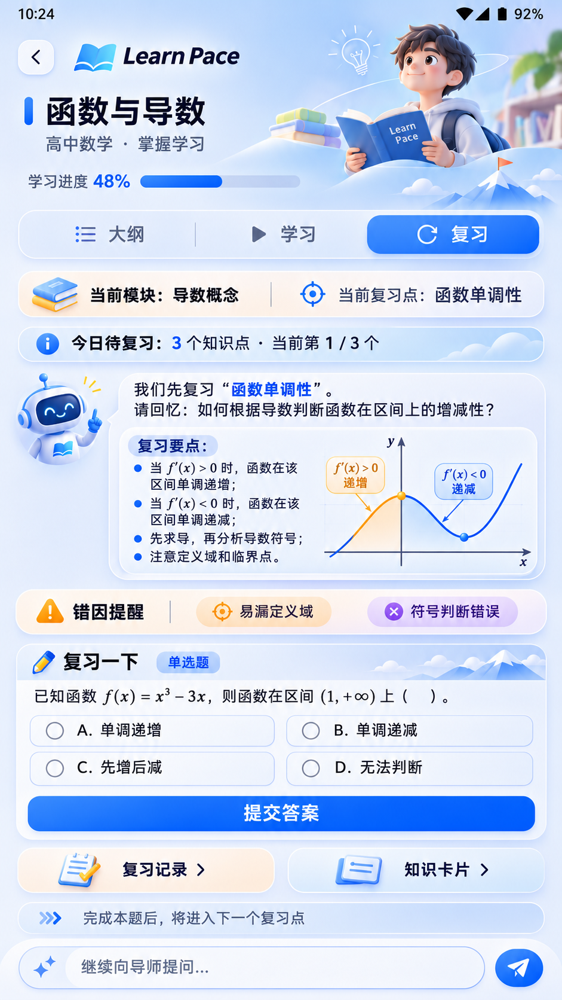
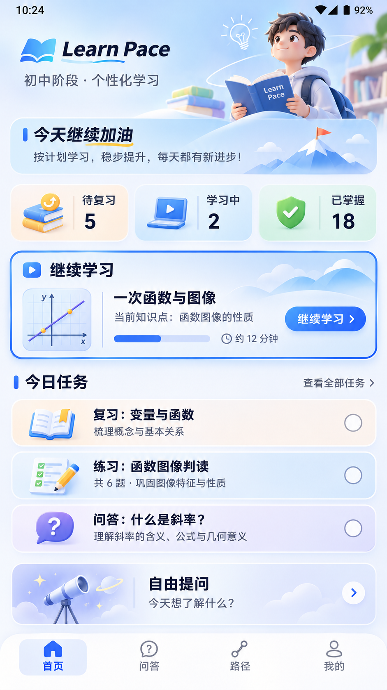
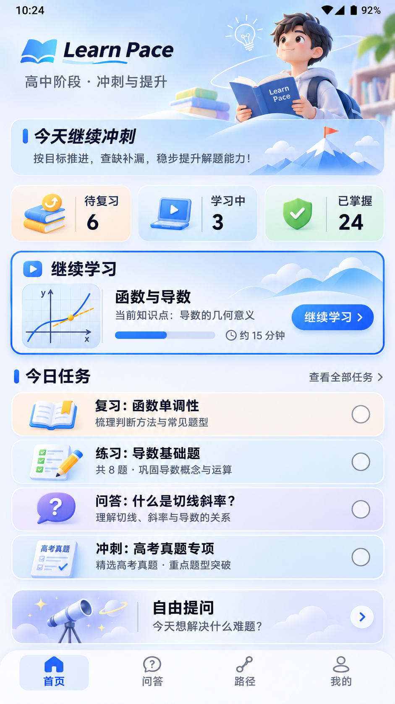
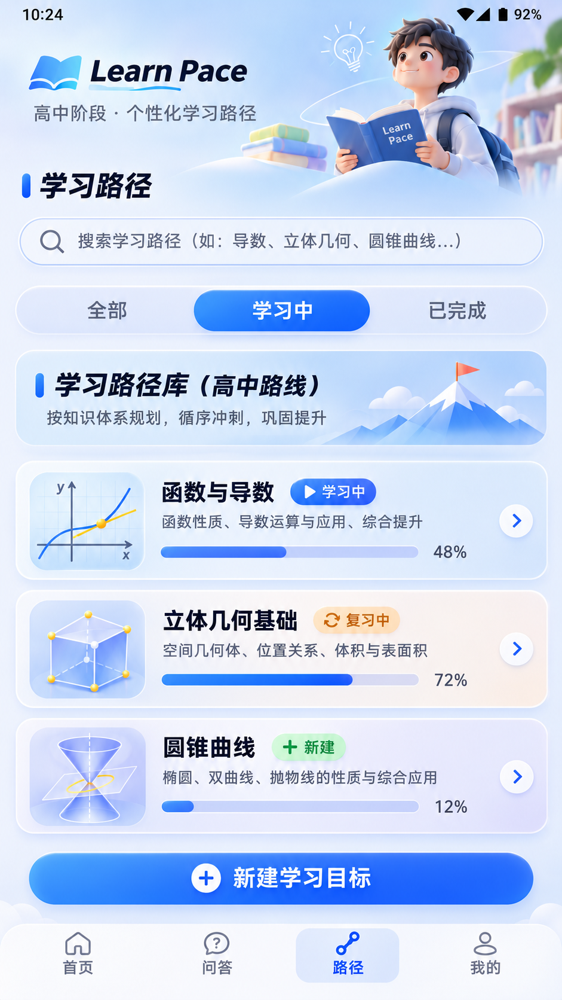
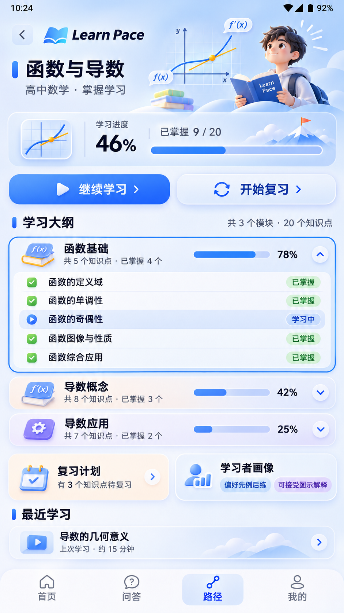
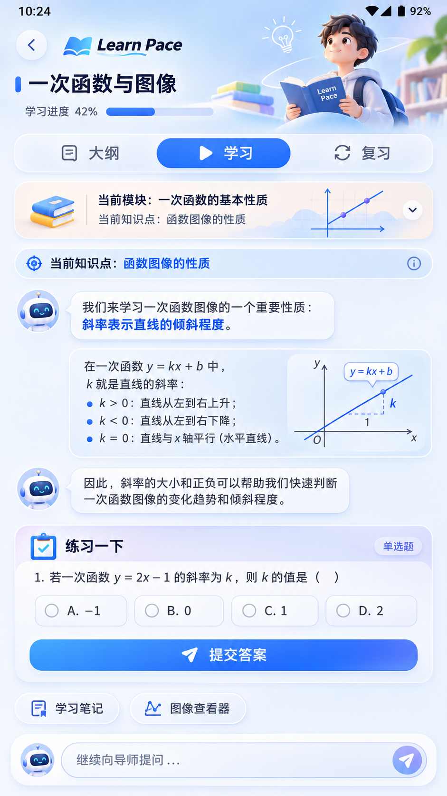
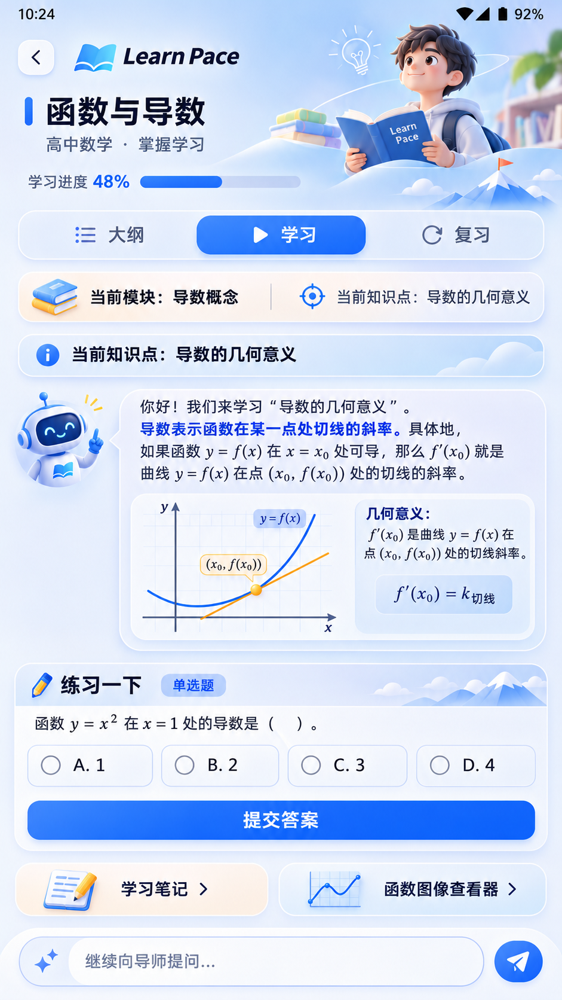

# 附录 A：原始界面原型与校验注释

以下保留原始效果图，未对画面进行修订；以正文第 11 节的校验结论为准。

## A.1 场景入口与复习入口

| F01 · 场景选择 | F12 · 高中 · Review |
| --- | --- |
|  |  |

**校验：** F01：场景选择应与 LF01/LF02 解耦；自由模式可直接进入，不强制选学段。F12：复习先独立检索，再按需提示；题卡提交后必须显示反馈、补救或下一日期。

## A.2 学习首页

| F02 · 初中 · 学习首页 | F07 · 高中 · 学习首页 |
| --- | --- |
|  |  |

**校验：** 两种学段共享首页结构和数据查询：待复习任务数、学习中路径数、已掌握目标数。高考真题等资源只有在具有真实授权来源时才显示；今日任务不能手动勾选即达标。

## A.3 学习路径列表

| F03 · 初中 · 路径列表 | F08 · 高中 · 路径列表 |
| --- | --- |
|  |  |

**校验：** 复用相同卡片、筛选和搜索。修正“学习中”筛选中的新建条目，以及新建状态的非零进度；复习中是任务/会话状态，不是独立路径生命周期。

## A.4 创建学习目标

| F04 · 初中 · 创建目标 | F09 · 高中 · 创建目标 |
| --- | --- |
|  |  |

**校验：** 明确目标→可选资料/模型→Outline 会话。当前图把两步标记和资料放在同屏：补齐第二步或改为单页表单。导师角色与实际模型分别配置。

## A.5 学习路径详情

| F05 · 初中 · 路径详情 | F10 · 高中 · 路径详情 |
| --- | --- |
|  |  |

**校验：** 两图应读取同一进度投影：已掌握数/总数；高中 9/20=45%，模块 4/5=80%。统一当前目标、复习任务与历史证据；点击知识点可查看评估依据。

## A.6 掌握学习工作台

| F06 · 初中 · Study | F11 · 高中 · Study |
| --- | --- |
|  |  |

**校验：** 两图展示 Study 而非 LF01。须补 Outline、诊断、定性检查、评估反馈、补救和恢复状态。修正初中 k=0 的一次函数定义；高中求导计算题应配几何意义的理解验证。

