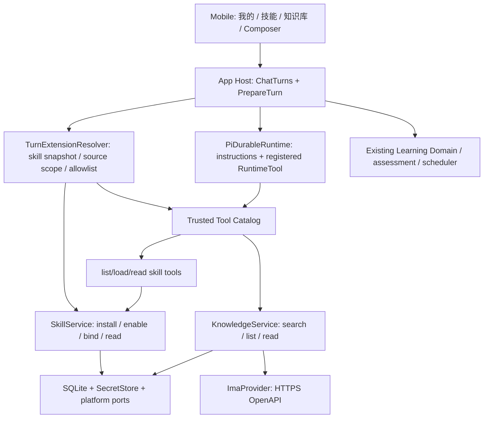
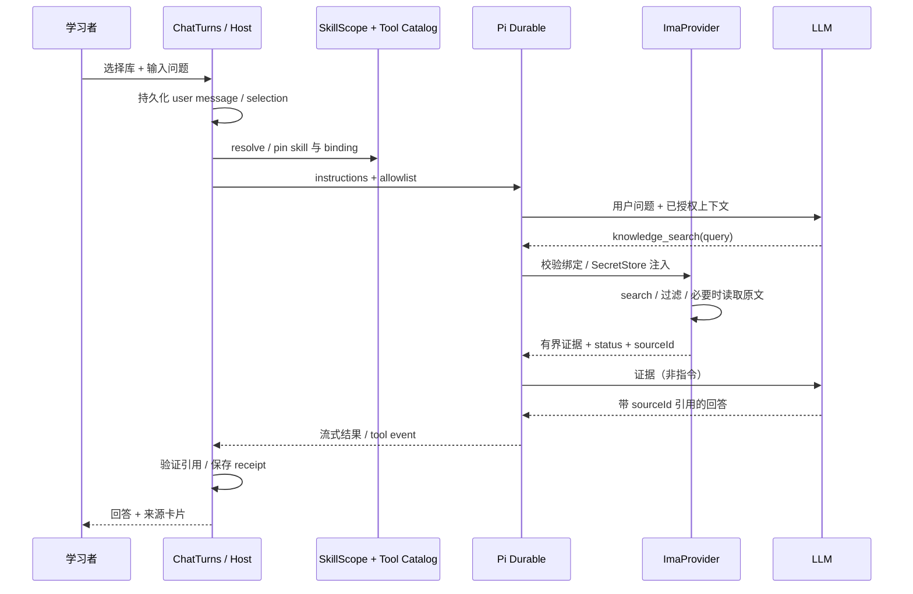

# Learn Pace · 移动端 Skill 管理与 ima 知识库扩展计划（V0.4 提案）

2026-11-26 · 基线：`docs/feasibility-plan` @ `2dd856df55cbc95f6e57e650a5c94c4feb07e141`。本稿是 M2-C 待评审增量，不宣称已实现，不回改已归档 Change 或 D1–D8；P0 仍为无外部知识库也可运行的 LF01/LF02，Skill/ima 是可选增强（P1）。Android ARM64 / Expo 58 / RN 0.88.1 / Hermes / Pi Durable 1.6.0 保持不变。

产品需求、使用场景与独立验收矩阵见 [PRD 10：移动端 Skill 管理与 ima 知识库扩展](../prd/10-mobile-skills-and-ima-knowledge.md)。本文继续作为技术设计及源码迁移依据。

## 1. 为什么现在做、范围与基线差异

当前分支已有 apps/mobile、packages/{domain,app-host,runtime,infra}，M1/S7 与 M2-A 真机验证记录、M2-B 事务/恢复/备份代码与归档规格。README 部分状态描述仍早于代码；以当前源码、OpenSpec 与归档验收记录为准，不据此声称本次重新跑过真机。现有 Runtime 每轮重建 Harness（MemoryStorage），本地业务存储才是历史权威；不替换 Pi、不复制 Cherry 的整个 Agent 管理系统。新增 Skill 包、连接和引用都不改变掌握度算法、评分事务或导航四 Tab。

## 2. Cherry Studio Mobile 的复用映射

固定子模块 `CherryHQ/cherry-studio-app@14a0224fcdce482a36298a364799c52bb98a8ae8`，按 D1/NOTICE 的既有授权和许可证记录复用。以下链接均相对 `upstream/cherry-studio-mobile/`：

| 上游模块 | 实际职责 | Learn Pace 迁移 |
|---|---|---|
| docs/references/agent/agent-skills.md | 发现、安装、使用、兼容性、权限、逐步披露 | 复用契约，简化为个人学习助手 |
| src/backend/services/skill/skillPackage.ts | YAML、路径、大小、manifest、内容哈希 | 移植纯 TS 验证和哈希逻辑，使用 RN 可用加密/字节适配 |
| src/backend/services/skill/skillSources.ts、skillArchive.ts | GitHub pin commit、ZIP 解析、拒绝 symlink | 本地文件/ZIP、公开 GitHub 精确目录；不引入市场 |
| src/backend/services/skill/skillStorage.ts | staging、版本文件、受控读 | 小包先采用 SQLite 原子发布，避免文件与 DB 双写；保留 SkillStorage port |
| src/backend/services/skill/skillCompatibility.ts | 脚本/工具缺失提示 | 区分可安装、可阅读、可执行；脚本仅作为资料 |
| migrations/sqlite-drizzle/0006_agent_skills.sql、src/backend/data/services/AgentGlobalSkillService.ts | 全局安装与 Agent binding | 简化为 Skill Library + 学习流程绑定；不新增 Agent CRUD |
| src/backend/ai/agent/host/skillScope.ts、skillInstructions.ts | 每轮 scope、pin revision、指令 | app-host 的 TurnExtensionResolver，先 explicit 注入，自动 load 用工具结果 |
| src/backend/ai/agent/tools/skill/skillTools.ts | list_local_skills/load_skill/list_skill_files/read_skill_file | 适配当前 RuntimeTool，按 scope 注册、限制大小与调用预算 |
| src/app/(drawer)/(main)/skills | 管理、详情与引用 | 「我的→技能」+ 问答 composer 芯片；复用本项目主题和 Shell |
| docs/references/agent/agent-tools-and-resources.md | Host 决定工具、连接、权限、每轮快照 | 独立能力目录；Skill 不创建工具、不授予权限 |

对照固定版本 [Cherry Skills](https://github.com/CherryHQ/cherry-studio-app/blob/14a0224fcdce482a36298a364799c52bb98a8ae8/docs/references/agent/agent-skills.md)、[Agent Skills 标准](https://agentskills.io/specification)。Cherry 有完整 Skill 市场、对话安装/创建/适配、MCP、通用 HTTP 和 QuickJS 能力；首期不整体迁移这些系统。上游支持读取含脚本的包，但没有包脚本执行器。Learn Pace 也不提供 shell、Python、Node、eval 或通用带密钥 HTTP 工具。

## 3. 架构与代码落点



依赖方向：UI -> app-host -> ports/runtime/infra；infra 的网络实现通过接口注入，runtime 只认识 RuntimeTool/JsonValue，domain 不认识 Skill、IMA、Expo 或 Pi。保持同一 Agent loop，不在 provider 中调用另一个 Agent。

| 现有代码 | 变更入口 |
|---|---|
| packages/app-host/src/chat-turns.ts | 用户结构化选择与回合 receipt；复用 PrepareTurn、replyMetadata、恢复/取消；失败码分离 |
| packages/app-host/src/lf01-chat.ts | prepare 当前创建 PiDurableRuntime、主问答注册导航工具，小老师提前 return；统一先装配扩展，再有条件注册导航工具 |
| packages/app-host/src/mastery/session-service.ts | 第 12 切片扩展 prepare；保留 pregrade、registerMasteryTools、动态 mode 检查、出题终止和 publish |
| packages/runtime/src/pi-durable-runtime.ts、index.ts | 已有 instructions、registerTool、allowedTools、AbortSignal、tool_call/result；不绑定 Skill SDK，不引入第二运行时；仅必要时扩展事件脱敏 |
| packages/app-host/src/app-bootstrap.ts | 注入单例 Skill/Connection/Knowledge 服务和 resolver；恢复后重建 |
| packages/infra/src/{index,expo,memory,migrations,snapshot}.ts | 扩展仓储、事务、SQLite v5 后迁移、内存实现及快照 |
| packages/app-host/src/{backup-format,backup-restore}.ts | 现 v1 严格 7 个 payload 字段、只特判模型凭据，必须随扩展调整；禁止将凭据放在通用 settings |
| apps/mobile/src/context/AppContext.tsx | 服务注入和 restart 刷新 |
| apps/mobile/app/(tabs)/me.tsx、src/components/{ChatConversation,chat-controls}.tsx | 「我的」增加技能/知识库入口；composer 结构化选择、执行状态及引用卡 |

建议新增 app-host/src/extensions/{skills,turn-scope,tool-catalog,knowledge}/；infra/src/extensions/ 放仓储、文件导入、HTTPS 适配；apps/mobile/app/settings/{skills,knowledge}/ 放子路由。实际文件命名可随实施调整。

## 4. 通用 Skill 生命周期

Skill 是指令及资源包，不是插件或授权。Skill ID 稳定，revision=内容 SHA-256（按 Cherry directory-sha256 算法）；安装来源和包名冲突必须检查。Library 与适用范围分离。

1. 「我的→技能」列表：名称、描述、来源、兼容性、启用状态；详情查看原始 Markdown、文件清单、版本、权限依赖和不可执行脚本说明。
2. 安装：系统文件选择器导入 SKILL.md / ZIP，或输入公开 GitHub 仓库、目录、SKILL.md 链接；多个候选时明确选择。先下载到有界临时内存，校验并预览，再由用户确认安装。GitHub ref 解析到 SHA；不支持私人 token、目录穿越、symlink、submodule、重复/大小写/Unicode 路径碰撞。
3. 默认不启用；用户可启用 LF01/小老师作用域，并在问答输入框「技能」菜单按本轮显式选择。暂不增加独立 Agent 管理；LF02 scope 后续打开。安装和启用不产生新工具权限。
4. 指令渐进披露：Host 仅提供有效 Skill 名称/描述或 list_local_skills 分页；显式选择直接装配已验版本正文；自动匹配经 load_skill；read_skill_file 只读本轮已加载包的清单路径。自动发现遵守 disable-model-invocation，显式选择遵守 user-invocable，二者独立。
5. 同轮 pin revision，不混用更新前后指令；更新预览差异并原子切换 active revision。停用/卸载立即阻止新调用；执行中 pin 的本地包可读直到回合结束（用户停用时可取消正在运行的回合），之后回收无引用旧包。历史保留名称、digest、实际 load receipt；重试旧版本不存在或无权时提示重新选择，绝不静默换版。
6. 首期兼容纯指令及文本 references；二进制/脚本可原样保留于包、不可执行或直接供模型读取。未知 allowed-tools 显示未满足，不授予能力；hooks、shell 插值、执行上下文覆盖不支持。限制建议每包 2 MiB、每文件 512 KiB、最多 100 文件、SKILL.md 正文 24k 字符；库总文件原始字节 4 MiB，最多每轮 3 个 Skill/24k 字符合计，单次引用最多 8k 字符；另按模型上下文和 token 预算截断/拒绝。超限不部分安装。
7. 无 function calling 能力时不宣称支持自动 Skill；保留阅读与普通聊天，显式调用缺工具时报清楚。第一模型仍 DeepSeek Flash。

数据建议：skills(id,name,description,origin,source_url,active_hash,enabled,profile,invocation)，skill_revisions(skill_id,hash,manifest,files_json_base64,created_at)，skill_bindings(skill_id,scope,enabled)。SQLite 事务发布版本与绑定，包字节/manifest 同一权威 DB；将选择写入 user.metadata.skill_selection，实际 loaded/失败写入 assistant.metadata.skill_receipts，不将整包重复写进消息。更新后清理未引用版本；历史 receipt 自包含但不保证旧包永存。备份 v2 包含有界包、绑定及历史记录；恢复 v1 后扩展为空、预览明确说明覆盖；恢复 v2 校验包内容及引用、全部恢复 Skill 默认停用待重新授权，原有历史可读。沿用 20 MiB 全备份限制，超限拒绝并提示，不能悄悄省略数据。导入包是用户资料，UI 提醒不得放秘密；不把真实连接凭据写入包，检测明显硬编码密钥并提示拒绝，不承诺识别任意用户文本秘密。

## 5. 扩展接口：Skill、Tool、Knowledge Provider 分离

```ts
type ExtensionScope = 'lf01' | 'little_tutor' | 'mastery';
type ToolRef = { source: 'builtin' | 'provider' | 'mcp'; capabilityId: string };
type SkillSelection = { skillId: string; revision: string };
type SourceBinding = { bindingId: string; connectionId: string; provider: string; remoteKbId: string };
type SourceRef = { bindingId: string; itemId: string; sourceId: string; title: string };
interface KnowledgeProvider {
  discover(input: { query?: string; cursor?: string; signal: AbortSignal }): Promise<LibraryPage>;
  browse(input: { binding: SourceBinding; folderId?: string; cursor?: string; signal: AbortSignal }): Promise<InventoryPage>;
  search(input: { binding: SourceBinding; query: string; topK: number; signal: AbortSignal }): Promise<RetrievalResult>;
  read(input: { binding: SourceBinding; source: SourceRef; signal: AbortSignal }): Promise<ReadResult>;
}
```

类型为设计草图，结果为 discriminated union（ready / partial / no_matches / not_configured / auth_denied / rate_limited / content_unavailable / network_error / cancelled），非数组空值吞错。Tool Catalog 由 Host 注册实现并合成 allowlist，Skill 的 allowed-tools 只是要求。第一期 Skill 加载只调用已存在学习导航/只读 Skill 工具；第 11 切片新增 knowledge_search/list/read；后续可接其它 HTTP Provider 或远程 MCP（MCP 尚无本项目实现，单独立项），绝不允许任意包自注册网络能力。scope 来自已保存 session/用户选择及真实绑定，不让 LLM 任意填 path_id、connectionId、凭据或 URL。

## 6. 首个外部知识库：ima（第 11 切片）

参考固定 DeepTutor `1284116f92368480aef3a47f91b8df9e9b105062`：
[ima client](https://github.com/HKUDS/DeepTutor/blob/1284116f92368480aef3a47f91b8df9e9b105062/deeptutor/services/rag/pipelines/ima/client.py)、
[transport](https://github.com/HKUDS/DeepTutor/blob/1284116f92368480aef3a47f91b8df9e9b105062/deeptutor/services/rag/pipelines/ima/transport.py)、
[pipeline](https://github.com/HKUDS/DeepTutor/blob/1284116f92368480aef3a47f91b8df9e9b105062/deeptutor/services/rag/pipelines/ima/pipeline.py)、
[sources](https://github.com/HKUDS/DeepTutor/blob/1284116f92368480aef3a47f91b8df9e9b105062/deeptutor/services/rag/pipelines/ima/sources.py)、
[media](https://github.com/HKUDS/DeepTutor/blob/1284116f92368480aef3a47f91b8df9e9b105062/deeptutor/services/rag/pipelines/ima/media.py)、
[tools](https://github.com/HKUDS/DeepTutor/blob/1284116f92368480aef3a47f91b8df9e9b105062/deeptutor/capabilities/ima/tools.py)。
官方 Skill 发布入口 [@tencent-adm/ima-skills](https://skillhub.cn/skills/ima-skills)，凭证入口 [ima Agent Interface](https://ima.qq.com/agent-interface)。参考官方脚本的 API 协议，不直接执行 Node/Python 或依赖 OpenClaw；内置移动兼容、只读的 ima-knowledge Skill，复用通用 Skill 管理与激活机制。若官方包可安装，也明确其脚本不能执行，不能把安装成功标为连接成功。

### 6.1 接口映射（以固定上游代码为依据，真实凭证需 PoC 核验）
全部 wiki API POST https://ima.qq.com/openapi/wiki/v1/{method}，JSON 请求；凭据 header 为 ima-openapi-clientid / ima-openapi-apikey。
| 方法 | 请求关键字段 | 用途 |
|---|---|---|
| search_knowledge_base | query,cursor,limit | 发现账号可访问库（分页） |
| get_knowledge_base | ids (最多20) | 连接探测、名称、描述 |
| get_knowledge_list | knowledge_base_id,folder_id?,cursor,limit | 库内目录浏览，目录不能作为证据 |
| search_knowledge | knowledge_base_id,query,cursor | 文档匹配、高亮片段；上游 client 未向 wire 传 limit，以页预算裁剪 |
| get_media_info | media_id | 原文元数据；笔记映射或短时签名下载 URL |
| /openapi/note/v1/get_doc_content | 按上游 notes.py | 只读已绑定库关联笔记正文，不做账号全局笔记检索 |
上游 envelope.py 区分 HTTP 与业务 code；订阅库可能可检索却不能读文件，不能承诺全库全文。PoC 对个人库/共享库/订阅库分别记录可列、可搜、可读、额度、权限及脱敏响应 fixture。

### 6.2 用户流程与交互

「我的→知识库→添加 ima」→ 说明查询/选中资料会分别发送给 ima/当前外部模型，用户确认 → 输入 Client ID/API Key（均 SecureStore，固定 https://ima.qq.com，不支持模型设置网关复用）→ 测试连接→分页选择库→保存本地只读绑定→问答 composer 点「知识库」选择库→明确选择（自动激活 ima-knowledge，也可手动选）→提问→检索过程→带来源回答→点击引用查看实际已用片段/原文（如有权限）。用户可关闭连接、换库、取消、删除本地绑定；不会删除远端库。普通问答默认无绑定时不发 ima 请求。小老师继承已授权父会话的明确绑定，不扩展范围；本轮选择持久化，换库只影响后续轮次；历史显示原库及来源。



### 6.3 检索与来源契约

检索策略参考 DeepTutor 默认 topK=10、最多3页、240字符以下候选补全文、每次最多4文档、单文档12k字符。移动端首个 gate 降低下载预算（建议单文件 5 MiB，正文总预算 24k 字符并按模型上下文进一步收紧）；首期覆盖高亮、笔记正文、可解析纯文本，PDF/DOCX 等二进制解析若无 RN 安全可用实现明确 partial/unsupported，后续增量引入，不强制本地完整 RAG。不要仅凭字符长度宣称内容充分；模型仍应检查相关性。搜索结果只来自选定库；目录与缺稳定 ID 条目不能引用；无正文/无法读取的文档不作为证据。browse 回应目录清单，不以 similarity search 冒充全量库存。

SourceLedger（Host 每轮）将 provider、connectionId、bindingId、remoteKbId、mediaId、实际文本、来源类型、检索时间和内容哈希映射到不透明 sourceId；read 只能读当前轮来自已授权库的已验证 handle，不接受模型任意 mediaId。模型引用 [S1] 等局部 ID；提交前校验真实 ID，未验证引用不能渲染成来源卡，必要时标明证据不足。message.metadata 保存有界证据快照和引用映射，离线可查看当时证据；不保存签名 URL 或原始 HTTP header，不伪造链接/页码。授权撤销停止新请求；历史用户已有的回答仍可离线读/删除，后续调用不自动重新注入已撤销资料，历史文本数据流须用户知情。首期不用为完整库做本地索引。

### 6.4 安全与恢复

固定 origin，credential 注入发生在 transport/SecretStore，模型、技能文件、日志、tool args/results/metadata、备份均不含真实凭证；只允许已定义 read-only 方法，禁任意 HTTP、跳转和写操作。媒体下载仅 HTTPS，信任严格腾讯资源 host/COS 域，禁重定向、禁转发 IMA 凭据和身份 header，内容大小/超时/取消有界；对返回正文、标题、包资源中的 prompt injection 按不可信数据隔离。权限变化每次调用复查本地授权与服务端结果，不可跨连接/库使用 handle。网络/429/认证失败、无匹配、有匹配无可读文本、部分可用分别显示；只读重试有明确预算，取消后不再发送新请求，历史部分结果保存。若用户选择仅知识库回答，失败时不得用模型常识冒充检索答案；可让用户显式选择继续普通问答。
Connection/Binding 持久化只存公开描述和 credential_ref；保密项独立、日志脱敏；备份导出 credential_ref=null，恢复后全部需显式重新连接并确认库，不按相同 origin 自动复用 ima 账号；恢复中不删本机凭据，按既有退休清理策略在成功配置新凭据后清理。验证连接、撤销、恢复与删除时不得对远端产生写副作用。

## 7. 第 12 切片：接入精通之路 LF02

在 LF01 可用后复用同一 KnowledgeProvider，不新增模式。
- 新建路径/编辑大纲：用户确认资料范围，检索+目录浏览生成大纲建议，保留 topic source 及来源快照；仍使用既有 preview/commit/CAS，不以搜到几条结果冒充完整课程。
- 学习模式：讲解/纠错按需要取材，题目与评分依据冻结；知识库资料不是学习者的 Evidence，不直接写 mastery。
- 复习/待答：复用当前独立性与 mode 权限规则，检索可在出题前或评分后用于教师侧，禁止把答案和检索片段无条件展示给待答学习者；若确有答案曝光，按现有 assisted/独立性机制记录真实事实。不得将所有追问自动标记辅助。
- 接入现有 prepare，不改变 pregrade、题卡终止、评分/证据事务、掌握度、Scheduler。明确失败保留题卡和原评分。用户离线可查看学习历史，但新库检索需联网。

## 8. 竖切路线 / Gate（仅第10切片详细 propose）

| 顺序 | Change | 交付 | Gate |
|---|---|---|---|
| 13 | m2d-mobile-skill-management | 导入/预览/启用/按需加载/引用文件、LF01与小老师、SQLite v6→v7、备份 `format_version: 2`（兼容 v1 schema 5/6） | 自定义教学 Skill 真机触发、关闭后不触发、无脚本执行、恶意包拒绝、恢复与原 P0/V0.4 回归通过 |
| 14 | m2d-ima-knowledge-lf01 | 通用 KnowledgeProvider + ima 只读连接、库选择、查询/原文/引用、兼容 Skill | 真机以真实 ima 库（含一个人工植入可核验的独有事实）完成配置、搜索、读、问答、断网、撤销及重启；没有额外服务 |
| 15 | m2d-knowledge-mastery | 路径绑定、Outline/Study/Review | 源证据与学习证据分离、题卡恢复、独立性、评分与复习回归 |
| 后续 | 待评审 | 技能市场/发布、远程 MCP、SkillHub/ima Skill 广场、其它 Provider、资料解析、写入 | 单独立项，不在 M2-D 承诺 |

继续沿用每次 propose 当前 Change、实施、验收、archive，再 propose 下一项的规则。第一项详规见 [m2d-mobile-skill-management](../../openspec/changes/archive/2026-11-26-m2d-mobile-skill-management/proposal.md)。

### 验证矩阵
- 基础：既有 LF01/LF02、M2-B CAS/幂等、备份、取消/强杀和恢复测试无回归；corepack pnpm typecheck / corepack pnpm test / openspec validate --all --strict。
- Skill：正常单文件/ZIP/公开 GitHub、冲突、路径穿越、恶意 YAML/zip bomb、超限、权限标志、引用越界、脚本仅可读、更新中断、并发停用、恢复 v1/v2、模型 tool calling。
- ima：凭证无效、越权库/handle、分页、重复 cursor、标题-only、无正文、订阅库拒读、partial、HTTP/业务错误、429、取消、超时、下载跳转、恶意正文、引用伪造、备份无凭证；通过 mock/fake transport + Android 真实账户最少一库验证。
- 真机性能：记录 APK 体积、冷启动、首次安装、首次模型响应、每次检索页数/全文次数、模型 token 与峰值内存，对比当前 M1 基线；先记录再定量门禁，不凭空承诺时延。
- 语义验证：相同问题对照无 Skill/有 Skill/有库+Skill；验证真实检索调用、独有事实与来源匹配、未检索不得伪造引用；不能只看输出像不像。

## 9. 决策与未验证事项

建议采用 M2-C 命名、P1 范围、只读 ima、单设备无额外后端、LF01 先验证再 LF02、SQLite 小包和新备份版本、手工导入/公开 GitHub 而非市场。这些为本次设计建议，未替用户冻结；若需完全复刻 Cherry 的安装市场/对话创建，需要扩展后续范围。真实 ima 凭证、官方发布版本的所有脚本、各类型知识库权限/限额、Android 解析与真机模型自动加载尚未联调；不承诺订阅库全文或全量第三方 Skill 可执行。上游授权来自仓库 D1，具体迁移文件仍需按 NOTICE/许可证审查。当前只提交方案与首个待评审 Change，不提交业务实现，不修改 main 或归档历史。


## 10. 实施校准与后续扩展契约（基线复核 `401cd47`）

本节补足 §4–§8 的实施歧义，不改变已提出的第10→11→12竖切顺序，不创建后续 Change。仍为待评审设计。以 Cherry Mobile 固定提交的 Skill service、SkillScope、skillTools、RuntimeTool/ToolRef 边界为参照，而非将其全量产品能力迁入。

### 10.1 两类 Skill、三项独立授权与后续接入

| 类型 | 例子 | 安装后如何可用 |
|---|---|---|
| 指令型 Skill | 苏格拉底提问、费曼检查、学习摘要 | 标准 SKILL.md + 文本 references，启用并绑定学习场景；无外部能力时仍可工作 |
| 连接型 Skill | ima 知识库；未来其它知识库或远程 MCP | 同一包管理机制；依赖 Host 已注册的可信 capability；用户另行配置连接、授权具体资料范围 |

**安装包 ≠ 启用 Skill ≠ 授权外部连接/工具。** 三者分别保存状态。任何第三方包不能以名称、origin、allowed-tools、metadata 或 instructions 冒充内置连接器。包支持标准 Agent Skills；若需依赖声明，可读取标准 allowed-tools 及 compatibility，Host 自有可信 capability descriptor 解析稳定 ID 与可用性，未知声明仅作提示，不执行任意脚本或任意 HTTP。第10项仅落地必要的 Skill scope/依赖就绪态及可信工具目录接口，不建设通用动态插件 SDK；第11项才注册真正的 ima Provider 及知识工具。

建议区分 `SkillPackage` / `InstalledSkill` / `SkillBinding`（流程、启用） / `ToolDescriptor`（稳定 capability ID、参数 schema、实现、模式准入） / `ProviderConnection`（provider 类型、credential_ref、连接状态） / `SourceBinding`（用户选中的库） / `TurnExtensionScope`（不可变版本、允许调用的工具与资料绑定）。ToolRef 未来按来源分区，MCP 身份使用 serverId + rawToolName，模型可见别名由 Host 生成，不用别名作为授权身份。首期不实现 MCP。

后续新增一个知识库扩展，原则上只需：实现 KnowledgeProvider 接口和 transport → 注册可信 descriptor 与连接配置/能力探测 → 提供可选移动兼容 Skill → 运行通用 provider conformance 与真机验收。LF01、LF02、Pi Runtime、掌握算法不新增厂商分支。仅有 SKILL.md 不能凭空获得新网络执行能力；可执行新 connector 仍需可信应用代码或将来单独评审的远程 MCP 机制。是否允许新 provider 写入须独立设计审批，不在此契约默认开放。

### 10.2 产品交互与状态：管理与学习入口分离

- 「我的 → 技能」：列表 / 导入预览 / 详情 / 启用 / LF01、Dito 绑定 / 更新 / 卸载；导入支持本地 SKILL.md、ZIP、公开 GitHub URL。查看包时展示已安装、已启用、当前场景可用、依赖缺失四类事实，安装成功不等于可执行。首期不引入市场、Agent CRUD、自由脚本、对话自动安装。
- 「我的 → 知识库」（第11项）：创建连接、测试凭据、分页发现库、选择只读库、查看状态、重新连接/断开；连接就绪、已绑定库与单次查询成功分别显示。连接断开不删除远端内容。
- LF01 composer 独立提供「技能」和「知识库」选择；Skill chip 存 ID+revision，知识库 chip 存 binding ID，发送后固定本轮范围。小老师只继承父会话实际授权的范围，不扩大权限；变更选择只影响后续轮。
- ima-knowledge 由应用提供只读移动兼容包，沿用通用安装/启用/调用与版本收据。首次配置可向用户明确提示启用；用户选择知识库是授权本轮资料范围，不自动安装或启用第三方 Skill。若已启用且允许 model invocation，可依据检索意图自动装配；若禁用自动调用，只允许符合 user-invocable 的显式选择。不把选择库变相当作绕过 invocation flag。知识工具本身由 Host 决定，不能由 Skill 授权；选择库但未启用 ima-knowledge 时，可使用 Host 的基础检索/来源规范，但不得宣称 Skill 已执行。
- 无库/无技能仍能完成原 LF01/LF02；仅知识库模式与普通问答有显式差异，检索失败不自动降级冒充资料回答。

### 10.3 现有源码中必须处理的三个 Runtime 边界

1. **准备失败与重试**：`packages/app-host/src/chat-turns.ts` 的 generate 当前只保留 VersionConflictError，其他 prepare 错误被折叠为 undefined。第10项应引入脱敏类型化 ExtensionPrepareError（revision_missing / scope_denied / dependency_missing / unsupported_model 等），明确 terminal 与 UI 恢复动作；不得静默换 Skill 版本或返回泛化模型故障。重试/重新生成复核保存的显式选择；自动加载记录实际 revision，历史收据不是新的自动授权。
2. **收据不是回答**：当前 end_turn 在 content 或 replyMetadata 存在时可标 committed。扩展收据（selected / loaded / dependency_missing / failed / cancelled）与业务可交付物分离；只出现 Skill/检索收据不应使空回答成功。保留现有 handoff/题卡的结构化终止语义。每个已完成的加载/读取保存轻量收据（turnId、stable ID、revision、状态，不保存凭据或全部原始结果），活跃工具在强杀后为 interrupted/unknown，不能伪造成功；成功/失败/取消终态与内容对齐。持久化 checkpoint 不得以旧 metadata 覆盖已提交的收据。
3. **同轮预算和竞争**：`pi-durable-runtime.ts` 的普通工具可能并发运行（仅存在 termination 时串行），默认 maxTurns=8；用每轮 shared budget/原子预留约束并发 load、reference、search、read，不能让并发绕过 3 Skills/24k 字符等上限。显式选择优先只注入已启用固定版本，自动发现仅提供有限描述、再 load；应用政策始终优先。原有 register_question / afterTools / beforeTool 终止和 allowlist 不改。若自动发现+加载+查询超过模型预算，返回明确不足，测试实际轮数和 token；必要时先交付显式调用，不宣称自动模式已通过。

### 10.4 第11项需冻结的知识来源契约（不提前生成详细 specs）

| 层次 | 权威事实 |
|---|---|
| Connection | 是否已配置、服务端探测、认证/限流错误；凭据只进受控 transport |
| Binding | 用户实际选中且授权的 remoteKbId，允许的操作范围只读 |
| Retrieval / SourceLedger | 每次搜索的 ready/partial/no_matches 等状态、实际文本、稳定 media ID、绑定及请求预算；只有真实可读内容可成为引用 |
| Answer | 经 Host 检查的真实 sourceId、用户看到的回答与有界快照；不能把标题当正文 |
| Learning evidence | LF02 的真实作答、评分、独立性和掌握度；知识库证据永不等同于学习证据 |

Provider conformance 至少覆盖分页/重复 cursor、查询限制、browse 与 search 区分、已授权库内 source handle、read 可用性/partial、业务 envelope 与 HTTP 状态、取消/超时、撤权、错误映射、引用可核验；fake provider 与 ima transport mock 共用合同测试，避免抽象只适用于 ima。真实库验证建议准备用户自建测试库，放一条独特、非敏感的事实并记录来源：无库基线不应知道该事实；选库+已启用 Skill 后必须有真实 load/search/read（需要全文时）收据，并且答案与可核验来源相符。另用不同库的反例验证不跨库，确认无匹配、无正文、拒绝读、断网、取消、凭据无效及断开后无新请求。真实账户的可列/可搜/可读范围与限额分开记录。

现有 ChatTurns.boundedHistory、Lf01ChatService.parentTranscript、选文、handoff 会将历史文本再次装配给模型；仅撤销 source handle 不会阻止已生成文本自动出网。第11项应在 Host 统一 provenance 检查：将外部来源关联到受影响的消息/摘要，授权撤销或备份恢复未重连时，自动历史/父会话上下文默认排除受影响内容（可保留本地显示与脱敏占位），不自动把旧正文通过普通模型请求再次外发；用户主动引用历史文本时显示数据流向并由用户明确选择，不能声称能识别所有人工复制的文本。第一期不做跨会话全文缓存；引用快照有界，备份大小预检。日志、运行时事件、异常、模型请求、导入文件、备份均须验证无真实凭据及无签名 URL。

### 10.5 第10项实施前的复核门槛

第10项仍是唯一已 propose 的 Change。实施顺序：原有 Runtime/备份回归基线 → 包校验与持久化 → 显式 Skill（LF01/Dito）→ 自动发现与引用读取 → 管理/选择交互 → 恢复、取消、安全与真机验收。增加三组回归：prepare 类型化错误与旧版重试；空回答+收据不能误报成功且原 handoff 正常；并发预算、停用/更新和恢复中的版本收据一致性。归档后再 propose ima；不因存在官方 Skill 就跳过真实 API 权限验证。第12项延后到第11项通过，以现有 Learning Domain 为权威。
