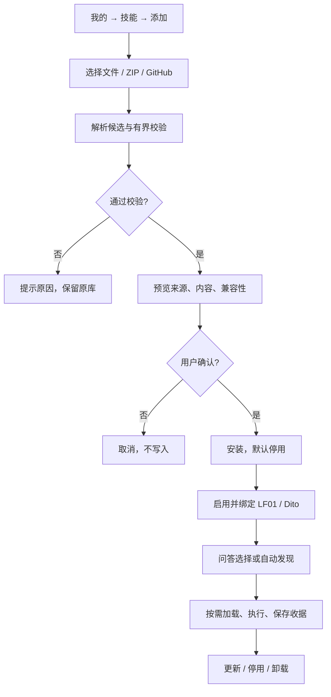
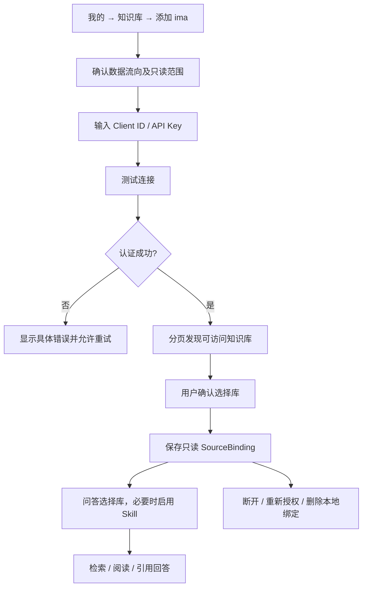
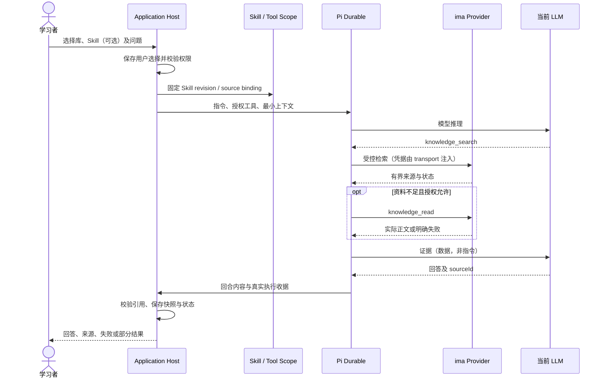

# 10 · 移动端 Skill 管理与 ima 知识库扩展 PRD

> 版本：V0.5 / M2-D 产品需求（由 V0.4 提案基线对齐至 `64d3034`）  
> 日期：2026-11-26  
> 范围为 P1 可选增强，M2-D 只读知识库相关切片为 Change 13 → 14a → 15。原提案的「切片 10/11/12」对应这三项，M2-C Change 10–12 已用于提醒、问答自测、错题与知识卡。Android ARM64 优先。
> 本文描述产品行为、业务规则与验收，不代表已实现或已通过测试。

本文定义移动端 Skill 与 ima 知识库的产品需求。技术方案记录架构、接口与预算，OpenSpec 路线记录竖切和验收门禁。Change 13 和只读知识库问答 Change 14a 的实施规格均已归档。Change 15 待立项，Change 14b 的受控上传需先补充产品需求和验收编号。P0 产品、评分、事务、恢复与 V0.4 既有规则继续以 PRD 00–09 与已归档 OpenSpec 为准。[技术方案](../evaluation/mobile-skill-ima-extension-plan-v0.4.md) · [OpenSpec 路线](../../openspec/ROADMAP.md) · [Change 13](../../openspec/changes/archive/2026-11-26-m2d-mobile-skill-management/proposal.md) · [Change 14a](../../openspec/changes/archive/2026-11-26-m2d-ima-knowledge-lf01/proposal.md) · [PRD 00–09](README.md)

## 1. 背景、问题与产品目标

### 1.1 背景

Learn Pace 已有移动端 App、Pi Durable Agent Runtime、LF01 问答/小老师（Dito）、LF02 精通之路及本地 SQLite 学习资产；M2-A 有真机验收记录，M2-B 已有事务、幂等、恢复、备份实现和归档规格。当前新增需求是以 Cherry Studio Mobile 的 Skill 生命周期为参考，让教学方法可以安装、管理和按需使用；以 DeepTutor 已有的 ima OpenAPI 集成为参考，让学习者无需重复导入已有知识库或部署独立 RAG 后端，即可使用授权资料学习。本次未重新执行上述历史验收。

| 用户问题 | 产品目标 | 结果 |
|---|---|---|
| 教学指令随客户端代码发布，新增教学方法成本高 | 建立标准 Skill 包管理 | 用户可导入、启用、更新和使用复用性学习策略 |
| 手机已有学习流程，但知识来源主要依赖模型 | 建立统一外部知识库能力 | 用户可选择自己的授权库检索和问答 |
| 外部知识服务的调用方式各异 | Skill 与可信 Tool/Provider 解耦 | 新 Provider 不需要重写 LF01/LF02 的学习流程 |
| AI 回答可能无来源、权限混乱或无法恢复 | 可追溯、可撤销的使用与来源记录 | 用户知道使用了什么 Skill、哪些资料、是否真实检索成功 |

### 1.2 目标用户与典型场景

| 场景 ID | 用户/场景 | 用户任务 | 预期价值 |
|---|---|---|---|
| UC-01 | 自学者、教学策略使用者 | 导入费曼学习法或苏格拉底提问 Skill，在问答中调用 | 同一应用支持不同辅导策略，无需重新开发 |
| UC-02 | 学习者 | 对不理解的内容打开 Dito 小老师，选择适用 Skill 追问 | 不破坏主会话，局部辅导可恢复 |
| UC-03 | ima 用户 | 连接既有个人/可访问知识库，查询特定概念或资料 | 不复制全库，基于已有资料学习 |
| UC-04 | 资料研究者 | 浏览库目录，询问某文档，追问原文依据 | 区分搜索匹配与实际库存，来源可核验 |
| UC-05 | 成人考证/系统自学者 | 将已授权知识库绑定精通目标，规划大纲、练习、复习 | 学习范围受资料约束，掌握仍由学习者表现决定 |
| UC-06 | 单设备使用者 | 更新/停用技能、断开库、备份并恢复 | 可控的权限、数据及历史，不丢失原学习资产 |

上述教学 Skill 为用户场景示例，不承诺首期预置所有教学方法；Change 10 用自定义教学 Skill 验证，Change 11 提供移动兼容 ima-knowledge。

### 1.3 成功定义与衡量

- 可用：在 Android 真机，用户不依赖电脑/NAS/Python/FastAPI 业务后端完成 Skill 导入到问答的闭环；真实 ima 库完成连接到有引用回答的闭环。
- 可验证：Skill 的选择、加载、工具调用/失败有不同收据；知识库回答能与真实检索、可读资料及来源 ID 对照，不能仅根据输出风格判断成功。
- 可扩展：以 fake provider 和 ima 共用合同测试证明接口不硬编码厂商；追加新知识服务不改变学习业务主体。
- 可控：无 Skill/无库时原 P0 闭环与 AC-01–08 不退化；越权、凭据泄漏、伪造来源和错误掌握写入属于阻断发布问题。
- 性能：记录安装/加载耗时、首字延迟、检索页数/全文读取数、模型 token、峰值内存、APK 体积并与现有 M1/M2 基线比较；具体 SLO 在 PoC 后评审，不预先承诺未测量的时间或准确率。

## 2. 范围与产品边界

| 阶段 | 交付 | 明确不在本阶段 |
|---|---|---|
| 10 · Skill 管理 | 本地/ZIP/公开 GitHub 导入、预览、启用、LF01/Dito 绑定、按需加载、版本/回合收据、备份兼容 | ima 网络、LF02 扩展 |
| 11 · ima 与 LF01 | 通用 KnowledgeProvider、ima 只读连接、库发现/绑定、浏览/检索/原文、带引用回答、Dito、撤权/恢复、ima-knowledge | 精通路径知识库绑定、写入和重型文件解析 |
| 12 · LF02 扩展 | 精通目标绑定资料、编辑大纲/学习/复习复用知识来源和适用 Skill | 新增学习模式或替换评分/掌握/调度引擎 |
| 后续另立项 | 市场/发布/自动安装/在线创建适配、课程包、其它 Provider、远程 MCP、完整本地 RAG、大文件处理、云同步/iOS | 不作为 M2-C Gate |

全阶段保持四个 Tab「学习 / 问答 / 精通之路 / 我的」、默认问答、单设备、本地优先及 DeepSeek Flash 首期模型基线。无外部配置可使用原 P0 功能；新检索和模型回答依赖网络，历史及学习进度支持原有离线浏览。无任意 Shell/Python/Node 脚本执行、eval、动态插件 SDK 或通用带密钥 HTTP；不自动上传全库，不创建、修改或删除 ima 内容。

## 3. 概念模型与授权原则

| 概念 | 责任及身份 | 不承担的职责 |
|---|---|---|
| SkillPackage / InstalledSkill | SKILL.md 与资源包；稳定 skillId、origin、revision/hash | 不执行任意程序、不授予工具 |
| SkillBinding | 已安装 Skill 对 LF01、Dito、后续 LF02 的启用作用域 | 不创建连接或扩大权限 |
| ToolDescriptor / ToolRef | Host 注册的能力、参数/结果契约、授权和执行 | 不由 Skill 声明或模型临时创造 |
| KnowledgeProvider | 统一的 discover/browse/search/read 接口，适配具体知识服务 | 不直接调用另一套 Agent、不拥有学习状态 |
| ProviderConnection | 服务类型、账号连接状态、保密凭据引用 | 不代表用户授权了全部可访问库 |
| SourceBinding | 用户明确授权的具体库、只读范围 | 不代表某次检索成功或该库全文可读 |
| TurnExtensionScope | 本轮固定 Skill revision、允许的 Tools、来源绑定、预算 | 不随模型任意传入的 ID、URL 或包内容而扩张 |
| SourceLedger / Citation | 实际检索/阅读证据、来源及引用映射 | 不作为学习者掌握证据 |
| Learning Evidence | 既有学习者作答、独立性、评分及评估证据 | 不由检索结果、Skill 结论或自报直接伪造 |

产品上区分**指令型 Skill**（教学/学习方法）与**连接型 Skill**（依赖已有可信工具的工作流）。两类使用同一标准包协议。安装包、启用 Skill、授权连接/资料三者独立；用户选择库不等于执行 Skill。Host 决定实际权限，模型和第三方包不得自行授权。已注册能力可被多个 Skill 复用。新增知识服务遵循「实现 Provider → 注册可信能力 → 配置连接及资料授权 → 可选兼容 Skill → 合同测试/真机验收」；不让 LF01/LF02 为每家厂商增加专用流程。

## 4. 信息架构与界面需求

P01–P07 原导航不变。以下为 M2-C 需求追踪用子页面 ID，不新增一级 Tab，也不复用已移除的 P00。设计沿用现有主题、Shell、消息组件及小屏交互，图像原型另行评审。

| 页面 ID | 入口 / 页面 | 必须展示及操作 | 切片 |
|---|---|---|---|
| P07-S1 | 我的 → 技能 | 已安装列表、名称/描述、启用状态、搜索、添加、空态 | 10 |
| P07-S2 | 技能详情 | 原始 Markdown、版本/来源、资源清单、依赖与兼容限制、启用/作用域、更新/卸载 | 10 |
| P07-S3 | 添加/更新预览 | 文件/ZIP/GitHub 输入、候选选择、校验、大小、差异及确认、进度/取消/失败 | 10 |
| P02-S | 问答 / Dito composer | 技能菜单、可移除的结构化 chip、可用性说明、选中状态、发送/停止/重试 | 10 |
| P07-K1 | 我的 → 知识库 | 连接列表、服务类型、已绑定库、状态、添加/断开 | 11 |
| P07-K2 | 添加/配置 ima | 数据流向说明、Client ID/API Key、测试连接、错误/重连 | 11 |
| P07-K3 | 选择库 / 库详情 | 搜索/分页可访问库、名称/描述、绑定/取消绑定、文件夹与文档浏览 | 11 |
| P02-K | 问答 / Dito composer | 独立知识库 chip、当前范围、仅知识库回答/普通问答的明确选择 | 11 |
| P02-R | 回答引用 / 执行详情 | 正文、检索/阅读状态、实际 Skill receipt、来源卡、历史片段、必要时读取原文 | 10/11 |
| P04-K / P05-K | 新建精通目标 / 路径资料 | 用户确认资料范围、绑定列表、换库/移除影响预览 | 12 |
| P06-K | 精通会话 | 大纲/学习/复习中资料来源及适用 Skill，待答时不得泄露答案 | 12 |

交互约束：选择状态随当前草稿保存，提交后记录本轮 ID/版本/绑定；删除 chip 不删除安装包或远端库；切换 Tab、关闭 Dito 或重启不重复出题、不重建已保存会话。外部连接页面返回原学习入口。当前回合的权限、选择、状态与历史收据不可被后续设置修改所覆盖。

## 5. 功能需求 A：Skill 管理（Change 10）

优先级说明：下表均为 M2-C 对应切片的必需需求（不改变全局 P1 定位），标为「验证门禁」的自动发现能力须实测，若未通过需明确调整范围并重新评审，不能默认为已实现。

| ID | 需求 | 产品规则与验收预期 |
|---|---|---|
| SKM-01 | 导入来源 | 系统文件选择器导入 SKILL.md / ZIP；输入公开 GitHub repo、目录或 SKILL.md URL，解析并固定 commit SHA；多个候选需用户选定；不依赖私有 token |
| SKM-02 | 预览及校验 | 安装前显示名称、描述、来源、资源、版本、大小与兼容性，用户明确确认；拒绝无效/恶意 YAML、缺名称描述、路径穿越、symlink/submodule、大小写/Unicode 路径冲突、压缩炸弹与超限，不部分安装 |
| SKM-03 | 安装及列表 | 原子保存通过校验的包、manifest/digest 与稳定 ID；默认停用；相同来源可识别，不允许不同来源同名静默覆盖；失败/取消保留原包 |
| SKM-04 | 查看及兼容性 | 展示原始 SKILL.md、文本 references、包版本/来源、需要的工具与环境；清楚区分已安装、已启用、当前 scope 可用及依赖未满足；未知工具不得视为已支持 |
| SKM-05 | 启用及作用域 | 用户分别启用 LF01 与 Dito；Change 10 不开放 LF02；禁用后新回合不得发现或加载，安装/启用不授予新能力；无 tool calling 的模型保留阅读和普通聊天，不能宣称自动 Skill 可用 |
| SKM-06 | 更新 | 有可解析上游来源时获取新固定版本，预览差异后原子切换 active revision；本轮仍 pin 旧版；同一来源可受控本地更新，不能让并行导入覆盖已确认版本 |
| SKM-07 | 停用及卸载 | 明确影响 scope/历史的确认；停用/卸载阻止新轮，运行中 pin 的本地包可保留到回合结束并提供取消；回收未引用包版本，保留历史事实；不删除用户学习资产 |
| SKM-08 | 资源安全与限制 | 包为数据而非插件；不支持 hooks、shell 插值及上下文覆盖；脚本/二进制可作为包资料保存，不执行；模型读取范围仅限已授权已加载版本内的支持文本资源，禁止任意绝对路径或跨包读取 |
| SKM-09 | 依赖就绪态 | 解析 allowed-tools/compatibility 作为声明；由 Host 可信目录解析稳定能力 ID 与实际可用性；包名、origin、metadata 不得冒充内置 connector；首期不建设动态代码/工具注册 SDK |

**首期建议容量限制**（沿用技术方案，真机评审可收紧）：单包 2 MiB、单文件 512 KiB、最多 100 个文件、SKILL.md 正文 24k 字符、全库原始文件字节 4 MiB。下载、解压、校验及备份以实际字节而非仅文件名/压缩大小约束；超限拒绝并给出可操作提示。revision 使用 Cherry directory-sha256 内容哈希；原始包与 manifest 同一权威存储。

### 5.1 导入与使用主流程

### 5.2 Skill 状态与展示

状态维度独立：Package（候选/安装中/已安装/损坏或缺失/已卸载），Scope（启用/停用/不适用），Compatibility（可用/缺工具/缺运行环境/模型不支持），Turn（已选择/已加载/已调用/失败/取消/未确认）。不要将这些组合成单个「成功」标识。缺脚本运行环境时可查看包，不允许伪造脚本执行结果；若实际任务只需现有工具，可按实际能力完成。

## 6. 功能需求 B：Skill Runtime 与问答使用（Change 10）

| ID | 需求 | 产品规则与验收预期 |
|---|---|---|
| SKR-01 | 显式调用 | composer 只展示当前可显式调用的 Skill；选择记录 skillId/revision，不以自由文本名称授权；发送前复查 scope/版本/必要依赖，显式正文按固定版本装配 |
| SKR-02 | 自动发现（验证门禁） | Agent 仅看到当前 scope 有效且允许 model invocation 的有限 name/description；通过 list_local_skills/load_skill 渐进加载，不全量注入所有包；遵守 disable-model-invocation |
| SKR-03 | 资源读取 | list_skill_files/read_skill_file 仅访问本轮已加载的固定版本和 manifest 内支持文本，拒绝跨包/路径越界；资源以不可信数据处理 |
| SKR-04 | 用户调用标志 | user-invocable=false 不进入显式选择；disable-model-invocation=true 不进入自动发现；两者独立，不得以其它入口绕过 |
| SKR-05 | 权限和预算 | Host 合并现有学习工具与本轮可用只读 Skill Tools；allowed-tools 只是依赖；并发共享/原子预留预算，最多每轮 3 Skills / 合计 24k 字符、单引用 8k 字符，另受模型上下文、token、调用次数及 maxTurns 约束 |
| SKR-06 | 历史收据 | 用户消息持久化选择；助手消息保存实际加载名称、ID、revision、执行/失败/取消状态及轻量工具收据；不复制整包；强杀未确认调用标 interrupted/unknown |
| SKR-07 | 重试与版本一致 | retry/regenerate 复查原显式选择、版本与授权；旧版不存在或无权时明确错误、引导重选且不请求模型，不静默换版；自动加载记录实际版本，历史不自动变成新授权 |
| SKR-08 | 回合成功条件 | 只有有效回答或既有合法业务交付物（如 handoff、题卡）才可成功；只有 Skill/工具收据而无答案不能标为回答成功；部分结果与状态一致 |
| SKR-09 | Dito 集成 | 保留父会话、选文、返回及保存恢复语义；仅使用 Dito 当前 scope 中已启用且允许的 Skill，不扩大父会话或当前权限；不自动推进精通状态 |
| SKR-10 | 基础兼容 | 无 Skill 时原 prompt、工具准入、问答、Dito、导航、停止、恢复和 LF02 保持既有语义；技术失败有可操作提示而非吞错后显示普通模型错误 |

显式选择时先固定版本后装配；自动发现以工具结果加载，不能假设与系统 prompt 优先级等价，必须在 DeepSeek Flash 真机验证。若自动发现无法满足正确率或预算，需提交评审决定是否仅发布显式调用。原 Agent Runtime 的 register_question、afterTools、beforeTool 与业务终止语义不变。

## 7. 功能需求 C：外部知识库管理与 ima（Change 11）

### 7.1 通用知识库能力

| ID | 需求 | 产品规则与验收预期 |
|---|---|---|
| KB-01 | Provider 抽象 | 提供 discover/browse/search/read 接口与结构化结果，支持取消、分页、错误及部分可用；不返回空数组掩盖故障；用 fake provider 与 ima 共用合同测试 |
| KB-02 | 连接管理 | 连接配置与库绑定分离；显示未配置/测试中/就绪/失败/已断开等状态及原因；同一连接可发现多个库，只有用户选择的具体库才可用于学习 |
| KB-03 | 授权与撤销 | 用户明确选择可用库、只读授权；连接就绪不等于库有权限或全文可读；换库只影响后续轮，关闭/撤销使新调用立即不可用并终止或拒绝后续活跃请求 |
| KB-04 | 目录与检索 | browse 返回真实文件夹、文档及分页，不以相似度搜索冒充全量库存；search 仅对已绑定库查询，folder/title-only 不能冒充可引用正文 |
| KB-05 | 来源读取 | read 只能消费当前轮已授权库内经验证的 source handle；不接受模型任意 mediaId、远端 URL、connectionId、凭据；区分高亮、笔记正文、纯文本、暂不可解析文件 |
| KB-06 | 后续接入 | 新 Provider 注册可信 capability 和连接/范围约束，保持同一 LF01/LF02 行为、错误/来源接口；可选配套 Skill；不允许仅凭 SKILL.md 自动执行未知网络操作 |

### 7.2 ima 专属需求

| ID | 需求 | 产品规则与验收预期 |
|---|---|---|
| IMA-01 | 新增连接 | 我的 → 知识库 → 添加 ima；显示查询会发送给 ima、选取证据会发送给当前外部模型及历史/备份保存规则，用户确认后输入 Client ID/API Key |
| IMA-02 | 凭据及连接探测 | 提供官方凭据入口，秘密写入 SecureStore，表仅存 credential_ref；固定 https://ima.qq.com，禁止复用模型网关；测试真实认证，错误/限流可区分，不泄漏密钥 |
| IMA-03 | 发现/选择知识库 | 分页查询账号可访问库，展示名称与描述；明确选择保存只读 SourceBinding，可刷新/重连；记录真实个人、共享、订阅库的可列/可搜/可读差异，不承诺全部内容权限 |
| IMA-04 | 浏览及检索 | 提供 knowledge_list / knowledge_search，真实调用指定库 API；分页/重复 cursor/结果预算受控，搜索返回有效片段及诊断，无法读正文时明确 partial 或 unavailable |
| IMA-05 | 原文读取与补充 | 使用 get_media_info；已绑定库关联笔记通过 get_doc_content，允许的纯文本/有界文件通过受控 HTTPS 读取；禁止账号全局笔记检索、任意下载、签名 URL 复用、写操作；PDF/DOCX 无安全移动端解析能力时如实提示 |
| IMA-06 | 移动兼容 Skill | 应用提供 ima-knowledge 标准 SKILL.md（只读检索/来源策略）；复用安装、启用、作用域、加载与 receipt；连接与 Skill 启用独立；官方原包即使能安装也不得执行其 Node/Python/Shell 脚本或将安装标为已连接 |
| IMA-07 | 断开与恢复 | 关闭/删除连接/库绑定仅改变本地，禁止删除远端资料；历史仍可本地查看和删除；恢复后的连接需显式重新配置和确认库，不按同 origin 自动复用账号凭据 |

接口依据为固定 DeepTutor 实现，不声称已完成真实调用。wiki API 使用 POST /openapi/wiki/v1/{method}，JSON 与 ima-openapi-clientid、ima-openapi-apikey headers。产品能力映射：

| 能力 | API（详见技术方案 §6） |
|---|---|
| 发现/连接验证 | search_knowledge_base、get_knowledge_base |
| 浏览目录 | get_knowledge_list |
| 检索资料 | search_knowledge |
| 读取媒体元数据及授权内容 | get_media_info |
| 读取关联笔记正文 | /openapi/note/v1/get_doc_content |

移动端检索建议沿用上游 topK=10、最多 3 页、240 字符以下优先补正文、最多补 4 个文档、每文档 12k 字符，移动端单文件 5 MiB、正文总预算 24k 字符并按上下文收紧。字符阈值只是补充候选依据，不等于证据充分；达到预算或部分失败时保留已有可用证据，禁止以无关资料填充。

### 7.3 连接及授权流程

## 8. 功能需求 D：基于知识库的 LF01 问答（Change 11）

| ID | 需求 | 产品规则与验收预期 |
|---|---|---|
| QA-01 | 来源选择 | 问答 composer 独立提供「技能」「知识库」选择；以 bindingId 提交，显示当前库；不选库不自动发送 ima 请求。首期可绑定多个库；建议单轮选一个，是否支持多库合并检索在 Change 11 评审冻结 |
| QA-02 | 组合使用 | 同一授权库可与费曼/苏格拉底等已启用 Skill 组合；ima-knowledge 已启用且允许自动调用时可按意图加载；显式路径遵守 user-invocable；未启用该 Skill 时仍可按 Host 基础检索与来源规则问答，不标为 Skill 已执行 |
| QA-03 | 知识库问答 | 用户选择仅知识库回答时须真实检索并依有效文本答复；必要时读取正文；信息不足明确说明，不能用模型常识冒充检索；用户可显式改为普通问答。普通问答中使用已选库时区分有来源结论与模型补充 |
| QA-04 | 过程反馈 | 展示正在检索、阅读、生成及失败/部分成功等可观察状态；支持停止、明确重试、返回历史，取消后不再发新请求 |
| QA-05 | 引用与证据 | 每轮 SourceLedger 保存真实库/文档 ID、title、来源类型、实际文本、检索时间、内容 hash 与不透明 sourceId；只允许引用经 Host 校验的可读来源，目录、仅标题、缺 ID 或伪造链接不得渲染为已验证来源 |
| QA-06 | 来源详情 | 回答显示真实引用卡，点击查看当时使用的有界片段/原文及可读限制；历史可离线查看快照；不保存签名 URL/原始 headers、不虚构页码或地址 |
| QA-07 | Dito 追问 | 从父消息选文开启小老师，继承父会话实际授权范围且复查当前授权；不扩展到未选库，保留父子关系与引用；断开后不自动加载历史外部内容 |
| QA-08 | 历史与隐私 | 历史消息/摘要关联来源 provenance；撤权/备份恢复未重连时自动历史、父会话记录、选文/交接相关内容默认过滤或脱敏占位，不自动向模型重发旧资料；用户主动引用已保存文本需明确知情选择；不能保证识别任意人工复制 |
| QA-09 | 回合保存与恢复 | 保存选择、实际检索状态、有效引用及有界快照；重启不需重新下载完整库；历史选择重试需重新检查当前权限；未授权/旧 handle 拒绝，不能静默换库或使用新版本冒充旧回答 |

### 8.1 主交互时序

### 8.2 异常与空态

| 状态 | 展示与操作 | 数据规则 |
|---|---|---|
| not_configured / auth_denied | 未配置、凭据失效或库无权；引导配置/重新授权 | 不请求未授权库，不向模型暴露凭据 |
| rate_limited / network_error / timeout | 限流、网络或超时原因；可控重试/取消 | 不无限重试；保留已完成内容与回执 |
| no_matches | 该查询未找到匹配资料；建议调整问题或显式普通问答 | 不虚构来源，不等同于库为空 |
| content_unavailable / unsupported | 有匹配但原文不可读/不支持格式；显示可用片段及限制 | 不将标题或目录作为正文证据 |
| partial | 有部分有效来源，其他来源不可读/受限 | 仅引用已验证有效文本，明确覆盖不完整 |
| cancelled / interrupted | 已停止或异常中断；允许重新提交或重试 | 不伪造完成收据、不再发新请求 |
| revision_missing / scope_denied / dependency_missing / unsupported_model | 明确 Skill 或绑定不满足的原因，提供重新选择/配置 | 不自动换版、扩权或将失败当普通模型故障 |
| restored / revoked | 需重新授权或连接；历史可读 | 默认不自动外发撤权资料，不重新执行历史工具 |

## 9. 功能需求 E：精通之路 LF02（Change 12）

Change 11 实际通过后，将相同 Skill/KnowledgeProvider 能力扩展到现有精通之路，不新增业务模式。

| ID | 需求 | 产品规则与验收预期 |
|---|---|---|
| MP-01 | 资料绑定 | 新建精通目标/从问答交接时由用户确认知识库及资料范围，保留稳定 topic source；路径内明确换库/移除影响，原有知识点、评分及历史不静默丢失 |
| MP-02 | 编辑大纲 | 根据授权目录和资料检索形成大纲建议，说明覆盖范围、来源及不足；沿用 preview/commit/CAS，不能把少数匹配结果宣称为完整课程 |
| MP-03 | 学习讲解与练习 | 在讲解、错因分析、费曼检查等适用任务中按需检索，使用适用 Skill；题目、答案和评分依据按既有规则冻结，资料引用与真实学习证据分离 |
| MP-04 | 待答与独立性 | 在待答/复习任务中不无条件把检索片段或答案展示给学习者；可在出题前/评分后用于导师侧；真实相关线索曝光按现有 assisted/独立性语义记录，不把所有追问自动标为辅助 |
| MP-05 | 评分和进阶 | 沿用现有 pregrade、题卡终止、评分、事务、证据、掌握规则与 Scheduler；Skill/来源内容不得直接修改掌握度、知识点状态和复习任务 |
| MP-06 | 复习和恢复 | 复习仍按现有计划；检索失败/授权撤销/强杀时保留原题、原答案及已提交评分；历史可浏览，无新检索时不能冒充新鲜资料；不得破坏原 AC-03–07 |
| MP-07 | 授权与删除 | 已绑定路径与当前知识库连接独立生命周期；撤权不删除学习资产，自动外发过滤延伸到路径资料与题目相关上下文；重新授权需确认具体库 |

## 10. 数据与非功能需求

### 10.1 数据契约（逻辑实体，物理表以技术方案为准）

| 对象 | 必要数据 / 事实 | 生命周期及约束 |
|---|---|---|
| Skill | ID、name、description、origin、source URL、active revision、invocation flags、compatibility | 安装/更新原子发布，卸载保留历史 receipt |
| SkillRevision | skillId、hash、manifest、有界包字节、时间 | 本轮 pin；无引用版本可回收，历史 receipt 自包含不保证旧包永存 |
| SkillBinding | skillId、scope、enabled | 用户明确启用，按 scope 拒绝越权 |
| ProviderConnection | connectionId、provider、描述、状态、credential_ref | 密钥仅 SecureStore；恢复后未配置/待重连 |
| SourceBinding | bindingId、connectionId、remoteKbId、名称、只读授权 | 用户确认；断开/删除不写远端 |
| Turn selection / receipt | turnId、skillId/revision、bindingId、实际执行状态、失败码 | 按 checkpoint/终态一致保存，强杀未确认不伪造成功 |
| SourceRef / Citation | 实际来源 ID、绑定、title、文本类型/片段、hash、时间 | 有界快照；来源撤权保留本地历史并限制自动外发 |
| Topic Source（12） | path/topic ID、已确认资料范围及来源引用 | 学习资料不是 learning_evidence，不改掌握写入规则 |

保留本地业务数据库为学习资产权威；不把 Pi MemoryStorage 当持久化系统。采用 SQLite 受限小包（SkillStorage port）与 RestoreGate/短事务方案，版本数据与 manifest 同一权威存储；Provider 网络调用与大文件校验不持有长期业务写锁。备份 V2 兼容 V1；当第11/12项扩展 payload 时重新校验格式与版本策略，不假设旧解析器自动接受新字段。

### 10.2 非功能需求

| ID | 要求 | 验收规则 |
|---|---|---|
| EXT-NFR-01 | 移动端独立性 | Android ARM64、Expo/RN/Hermes/Pi Durable 现有架构；无强制独立服务器，不引入 Node 运行环境 |
| EXT-NFR-02 | 最小权限 | Host 可信工具目录、版本 scope、source binding 和每次调用复查；包/检索内容作为不可信数据，不得修改系统策略、授予工具或访问任意文件 |
| EXT-NFR-03 | 凭据和传输 | Client ID/API Key、签名下载 URL、身份 headers 不进入模型、日志、消息、工具收据、备份；固定 HTTPS origin；媒体仅允许受信腾讯资源 host/COS 域、禁止重定向及转发 ima 凭据，大小、超时、取消受控 |
| EXT-NFR-04 | 原子性与恢复 | 安装/更新/卸载/绑定/备份恢复需事务/RestoreGate；保留已有 CAS、幂等及评分语义；回合 checkpoint 合并 receipt 不覆盖已确认结果 |
| EXT-NFR-05 | 备份与删除 | V1 校验后兼容恢复，提示扩展库为空；V2 校验 hash/引用/路径/大小及完整性，包含有界包、绑定、历史、来源快照而非秘密；恢复默认停用 Skill、库待重新授权；20 MiB 全备份上限，超限拒绝不悄悄省略，失败保留原数据与凭据 |
| EXT-NFR-06 | 可观测性 | 记录实际 Skill/检索/读取状态、脱敏错误、调用预算、来源和版本；不因存在 receipt 将空回答标成功 |
| EXT-NFR-07 | 性能与预算 | 包、引用、检索、下载、模型上下文及并发总预算受控；记录真机性能与基线差值，PoC 后确认量化发布阈值 |
| EXT-NFR-08 | 兼容性与可维护 | 标准 Agent Skills 文件协议；可安装不等于可执行；迁移复用符合 D1/NOTICE/许可证；模型工具调用能力不具备时明确限制，不破坏普通问答 |
| EXT-NFR-09 | 隐私与用户控制 | 数据流向知情、用户可查看/删除/导出、撤权后不自动出网；明显硬编码密钥拒绝/提示但不宣称可识别所有用户文本秘密；公开面向未成年人上线前另行评估保护与合规 |
| EXT-NFR-10 | 回归与扩展 | 无 Skill/无库原 P0 功能全量回归；新增 provider 用共用合同测试证明不依赖厂商；不修改 Domain 权威规则 |

## 11. 验收矩阵及发布 Gate

以下为 M2-C 独立验收编号，不替换 [AC-01–08](09-acceptance-criteria.md)。所有状态初始为待验证。自动化需覆盖正常、失败、取消、越权与恢复，真实账号和 Android 真机验收不得用 mock 代替。

| 验收 ID | Given / When | Then：可观察的通过条件 | 对应需求 |
|---|---|---|---|
| AC-M2C-10-01 | 导入合法 SKILL.md、ZIP、公开 GitHub | 预览/确认后保存正确 hash，默认停用；GitHub 固定 SHA；取消不安装 | SKM-01–04 |
| AC-M2C-10-02 | 恶意 YAML、zip bomb、路径碰撞/越界、超限、同名异源、脚本 | 无部分安装/执行/权限扩张；旧库完整，兼容限制真实 | SKM-02/03/08/09 |
| AC-M2C-10-03 | LF01 与 Dito 各启用自定义教学 Skill，显式发送 | 实际加载固定版本，按策略回答，保存选择与 receipt；未绑定场景不可用 | SKM-05，SKR-01/04/06/09 |
| AC-M2C-10-04 | 模型自动发现、按需加载和读取 reference；并发超预算 | 只发现允许 scope，成功读取已授权文本，不能越界；预算不会被并发绕过；自动模式失败须评审调整 | SKR-02–05 |
| AC-M2C-10-05 | 运行中更新、停用/卸载、重试旧版、强杀 | 当前 pin 不混版，新轮禁用生效；无权/缺失不请求模型；receipt 一致，空回答不误报成功，handoff 保持 | SKM-06/07，SKR-06–08 |
| AC-M2C-10-06 | 导出/恢复 v1/v2，故障注入、超限 | 旧库恢复明确覆盖，V2 包有效且默认停用；损坏拒绝、原数据不丢、密钥不进备份 | EXT-NFR-03–05 |
| AC-M2C-10-07 | Android 真机无 Skill、不可用模型/工具以及原 P0 回归 | LF01/Dito/LF02 正常；错误可操作；AC-01–08 与 M2-B 原回归不退化 | SKR-09/10，EXT-NFR-01/07/08/10 |
| AC-M2C-11-01 | 真实 ima 账号，输入凭据、探测、发现、选择库 | 连接与绑定独立，实际库可列；记录个人/共享/订阅库可列/可搜/可读范围与额度（可取得者）；无密钥泄漏 | KB-01–03，IMA-01–03 |
| AC-M2C-11-02 | 授权库放置模型不能预知的独有非敏感测试事实，另库放反例 | 无库基线不应知道事实；选库并启用 ima-knowledge 后观察真实 load/search/read（需全文时）收据、答案与来源完全对照；不能跨库 | KB-04–06，IMA-04–06，QA-01–03/05 |
| AC-M2C-11-03 | 目录浏览、分页/重复 cursor、仅标题、无正文、笔记/文本、不可解析文件、拒绝读 | 目录与搜索结果区分；partial/unavailable 等状态真实；只有可读且有稳定 ID 的资料可引用；不伪造原文 | KB-04/05，IMA-04/05，QA-05/06 |
| AC-M2C-11-04 | 断网、429、过期凭据、越权 handle、恶意正文、取消/超时、伪造引用 | 错误区分，预算受控，无额外请求/权限泄漏；仅知识库模式不冒充答案；引用经 Host 校验 | KB-01/03/05，QA-03–05，EXT-NFR-02/03 |
| AC-M2C-11-05 | Dito 追问、断开库、切换库、备份恢复、重新授权 | 历史来源与收据保持，撤权后无新调用及自动历史外发；重连需明确选择，无远端写入 | IMA-07，QA-06–09，EXT-NFR-05/09 |
| AC-M2C-11-06 | fake provider 合同与 ima mock/真实 Android 对照 | 同一合同支持另一数据源；不依赖额外业务后端或厂商专用学习流程；记录性能及未覆盖权限 | KB-01/06，EXT-NFR-01/07/10 |
| AC-M2C-12-01 | 从问答转精通目标，绑定库、生成/修订大纲 | 用户确认范围，保留真实来源与稳定 topic ID，原 CAS/预览不退化 | MP-01/02 |
| AC-M2C-12-02 | 在学习/复习中调用 Skill 与检索，独立答/辅助答、质疑和补救 | 引用仅为资料；题卡与评分依据冻结；不泄露待答答案；真实作答证据、独立性、掌握、复习沿用现有引擎 | MP-03–05 |
| AC-M2C-12-03 | 有待答题时断网/撤权/强杀、恢复与重试，原路径回归 | 原题、作答、评分、复习状态正确恢复；无重复计分，AC-03–07 不退化；无未授权资料自动外发 | MP-06/07，EXT-NFR-04/10 |

**Gate 10**：自定义 Skill 在真实 Android / DeepSeek Flash 验证导入、启用、显式/自动调用及引用资源（自动能力不通过需明确评审）、停用、更新、恢复与原业务回归；通过后归档 Change 10。  
**Gate 11**：真实 ima 测试库闭环、真实独有事实和来源对照、无额外业务服务器、凭据/撤权安全验证、通用 Provider 合同测试；通过后归档 Change 11。  
**Gate 12**：LF02 资料绑定/教学/复习真实集成，源证据与学习证据分离，既有评分事务、恢复与复习 Gate 不退化。  
每一切片需按仓库规则执行 corepack pnpm typecheck、corepack pnpm test、openspec validate --all --strict 以及对应真机验收；任务未完成不得提前勾选或归档。

## 12. 需求—实现追踪与待决项

| 需求族 | 主要实施归属 | 文档来源 |
|---|---|---|
| SKM / SKR | Change 13（`m2d-mobile-skill-management`）：mobile-skill-management、skill-turn-runtime、local-storage、local-backup-restore、lf01-chat；app-host、infra、runtime、mobile | V0.4 §2–5、§10.1–3；当前 [OpenSpec](../../openspec/changes/archive/2026-11-26-m2d-mobile-skill-management/proposal.md) |
| KB / IMA / QA | Change 14a（`m2d-ima-knowledge-lf01`），只读 `KnowledgeProvider`、ima 原文读取与 LF01／小老师带引用问答 | [OpenSpec 归档提案](../../openspec/changes/archive/2026-11-26-m2d-ima-knowledge-lf01/proposal.md)，V0.4 §5–6、§10.4 |
| MP | Change 15（`m2d-knowledge-mastery`），知识库与精通之路，待立项 | V0.4 §7 |
| EXT-NFR / AC-M2C | 各切片的安全、备份、恢复、真机 Gate；Change 10 包含 local-backup-restore delta | V0.4 §8–10；PRD 08/09 |

待评审/验证，不预先宣称已通过：SQLite 包与下载预算的真机适用性、自动发现模型轮次与 token、官方 ima Skill 脚本/API 最新契约及真实账号权限/额度、媒体格式解析覆盖、同轮单库或多库 UI 策略（建议首期单库）、来源快照/备份容量、具体性能 SLO、复用文件的许可证归属。现有 M2-C 范围建议（手工导入、只读、无市场/脚本、先 LF01 再 LF02）未被技术方案单方面冻结；本次形成需求提案供产品评审，后续按 Gate 调整并同步需求 ID。未修改历史评审决议。

## 13. 参考与版本

- [M2-C 技术方案 V0.4](../evaluation/mobile-skill-ima-extension-plan-v0.4.md)，其中 §10 对 §6.2 的 Skill 自动激活语义作校准：选择库不自动安装/启用 Skill，不绕过 invocation flags。
- [Learn Pace 现有 PRD](README.md)、[DeepTutor 手机版复刻方案 V0.3](../evaluation/deeptutor-mobile-parity-plan-v0.3.md)、[OpenSpec 实施路线](../../openspec/ROADMAP.md)。
- [Cherry Studio Mobile Skill 设计](https://github.com/CherryHQ/cherry-studio-app/blob/14a0224fcdce482a36298a364799c52bb98a8ae8/docs/references/agent/agent-skills.md)、[Tool 与权限架构](https://github.com/CherryHQ/cherry-studio-app/blob/14a0224fcdce482a36298a364799c52bb98a8ae8/docs/references/agent/agent-tools-and-resources.md)；固定子模块。
- [DeepTutor ima RAG Provider](https://github.com/HKUDS/DeepTutor/tree/1284116f92368480aef3a47f91b8df9e9b105062/deeptutor/services/rag/pipelines/ima)、[ima Agent tools](https://github.com/HKUDS/DeepTutor/tree/1284116f92368480aef3a47f91b8df9e9b105062/deeptutor/capabilities/ima)；固定子模块。
- [Agent Skills specification](https://agentskills.io/specification)、[ima 官方 Skill 发布入口](https://skillhub.cn/skills/ima-skills)、[ima Agent 配置](https://ima.qq.com/agent-interface)；沿用技术方案的参考入口，真实 API 与当前发布版本需联调核验。
